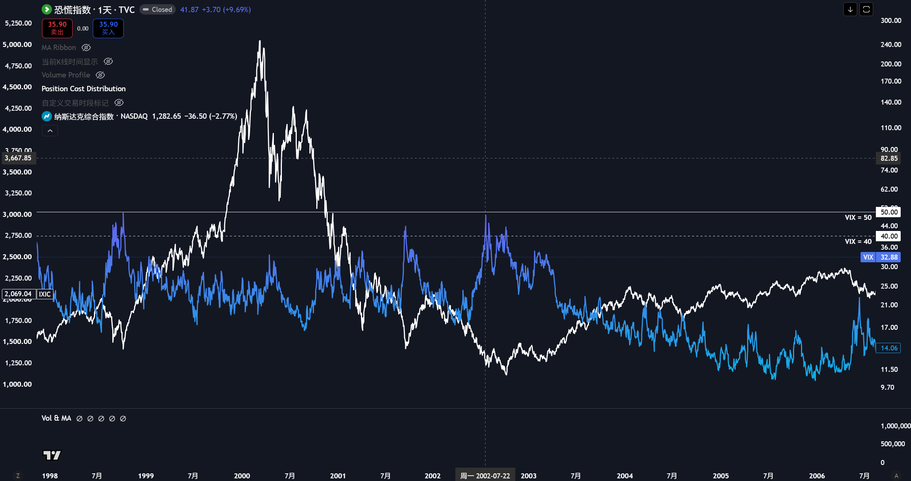

标普方面，VIX最高摸到40之后上涨概率在四个统计周期层面上都更高，但是仍然会出现下跌的情况（互联网泡沫已经开始磨底后仍出现较大回撤）。VIX摸到50之后接下来一个月之内表现都比较糟糕，但长线表现更好。

**标普500 + VIX首次突破40，n=34：**

| 持有期 | 平均收益 | 基准均值 | 最高收益 | 最低收益 | 上涨概率 | 基准上涨概率 | 概率差值 |
|---|---:|---:|---:|---:|---:|---:|---:|
| 下一交易日 | +0.61% | +0.03% | +5.42%（08年否决救市） | −3.43%（02年） | 61.8% | 53.6% | +8.2% |
| 1个月 | +2.83% | +0.71% | +17.42%（02年World破产） | −18.33%（雷曼破产）| 79.4% | 63.2% | +16.2% |
| 3个月 | +6.97% | +2.14% | +22.78% | −26.62% | 79.4% | 67.8% | +11.6% |
| 12个月 | +21.95% | +8.59% | +46.50% | −17.00% | 88.2% （30/34） | 77.1% | +11.1% | 

---

**标普500 + VIX首次突破50，n=11：**

| 持有期 | 平均收益 | 基准均值 | 最高收益 | 最低收益 | 上涨概率 | 基准上涨概率 | 概率差值 |
|---|---:|---:|---:|---:|---:|---:|---:|
| 下一交易日 | −1.79% | +0.03% | +1.04%（24年日元套息） | −7.60%（新冠） | 27.3% | 53.6% | **−26.3%** |
| 1个月 | +2.67% | +0.71% | +22.41%（09年低点） | −14.38%（08年衰退） | 54.5% | 63.2% | **−8.7%** |
| 3个月 | +13.30% | +2.14% | +37.73% | −11.56% | 72.7% | 67.8% | +4.9% |
| 12个月 | +31.15% | +8.59% | +66.83% | −0.21% | 90.9% | 77.1% | +13.8% |

---

**IXIC纳斯达克综合指数 + VIX首次突破40， n=34：**

| 持有期 | 平均收益 | 基准均值 | 最高收益 | 最低收益 | 上涨概率 | 基准上涨概率 | 概率差值 |
|---|---:|---:|---:|---:|---:|---:|---:|
| 下一交易日 | +0.63% | +0.05% | +5.45% | −4.81% | 64.7% | 54.7% | +10.0% |
| 1个月 | +3.93% | +1.03% | +22.99%（2002年） | −19.51% | 73.5% | 62.6% | +10.9% |
| 3个月 | +11.21% | +3.14% | +30.95% | −29.41% | 82.4% | 67.4% | +15.0% |
| 12个月 | +35.95% | +13.18% | +82.71% | −20.38% | 91.2% （31/34） | 76.2% | +15.0% |

---

**IXIC纳斯达克综合指数 + VIX首次突破50， n=11：**

| 持有期 | 平均收益 | 基准均值 | 最高收益 | 最低收益 | 上涨概率 | 基准上涨概率 | 概率差值 |
|---|---:|---:|---:|---:|---:|---:|---:|
| 下一交易日 | −1.68% | +0.05% | +1.49%（08年TARP救市）| −7.29%（新冠） | 18.2% | 54.7% | **−36.5%** |
| 1个月 | +4.57% | +1.03% | +23.63%（2009年底部） | −13.65%（2008年） | 63.6% | 62.6% | +1.1% |
| 3个月 | +17.44% | +3.14% | +42.31% | −11.30% | 90.9% | 67.4% | +23.5% |
| 12个月 | +42.09% | +13.18% | +79.01% | +3.65% | 100.0% | 76.2% | +23.8% |

---

**在上述的统计当中几乎没有任何数据反应2000年互联网泡沫的下跌**，主要原因是当时的下跌属于阴跌，即使是冲顶后的下跌也没有非常剧烈，因此只有两次VIX大于40的情况收录到了实际的统计样本当中。

备注：统计时使用的定义
- **首次突破**：前一交易日VIX最高值≤阈值，当日最高值>阈值。连续超阈值只计首日，回落后再次突破重新计数。
- **基准**：在同一时期内，从每一个交易日收盘出发，计算相同期限的收益，不加VIX条件。

