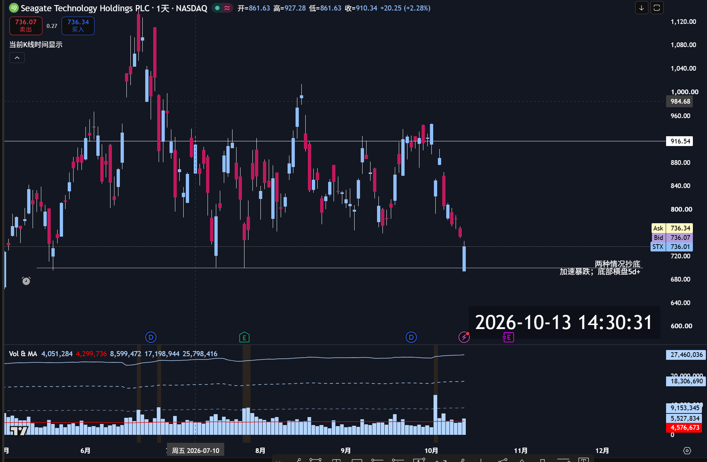

昨天说要耐心等待更好的机会然后敢于重仓，今天机会就来了：国内长鑫存储要提高存储生产效率，于是夜盘的时候希捷-6%，SNDK和美光-5%。希捷正好触碰到昨天标出来的急跌抄底位置。开盘观察了一下，很快从695跳到710然后回落到703-705，于是705直接50%仓位（也是运气好，昨天全部止损今天没有吃到这部分亏损），然后就有盈利了。不过，**一定要注意机会的质量，不要盲目的去做，不要想着一直赚钱，震荡市不亏就是赚，多做波段多等待好的抄底机会少追高**

观察到一个好像是做光模块的票SMTC，这段时间能新高，据说明年PE只有10倍营收同比翻倍，或许过两天应该研究一下；存储管理软件的两个票P和NTAP最近有横盘的感觉，或许需要回调一下。如果要是回调-15%了可以多上一点仓位；继续走趋势就不追高了。不要眼馋别人赚钱，追高其实很难做，因为止盈需要非常精准才行。