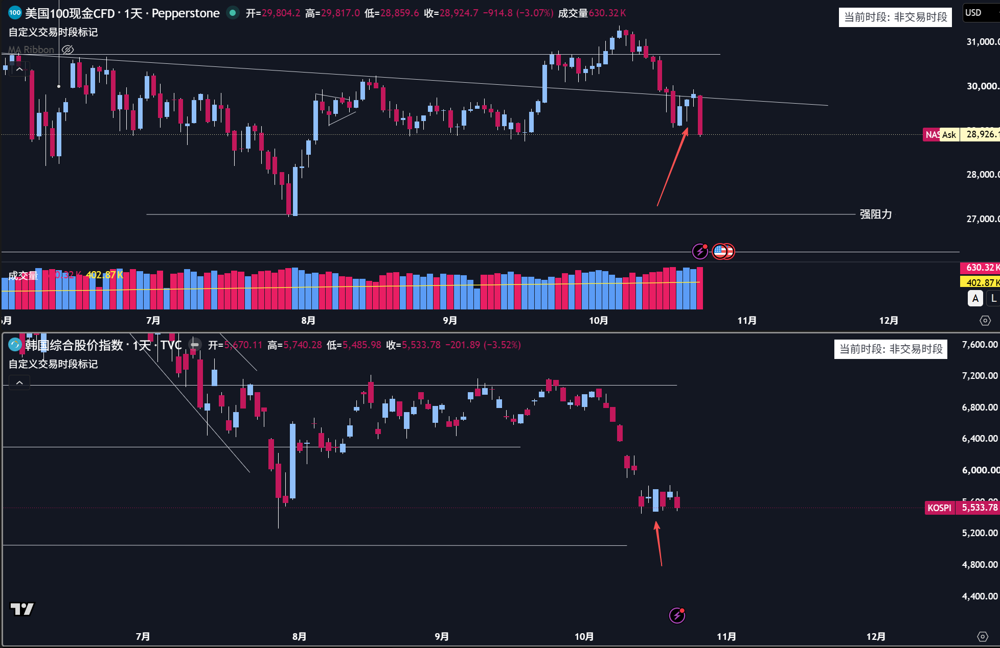

前两天说可能没跌完的原因主要是大盘和跨资产的一些异常：通常硬件板块经历暴跌之后的反弹也要强反弹才可能逆转趋势，但是纳指第二天盘前下跌开盘后拉回形成一根很长的下影线；韩国股指在熔断+暴跌到前面关键位之后没有一点像样的大幅度的反弹，所以就预感大部分票就算跌倒前面关键位可能也要破位下跌了。于是在抄底失败后全部清仓。虽然清仓没有抓住反弹的时候清仓，但至少是留住大量的现金，为后续可能的抄底做准备了。只是可惜了某个没杠杆的账户还有些现货黄金也被带下水了一些，或许也要考虑跑路了。
