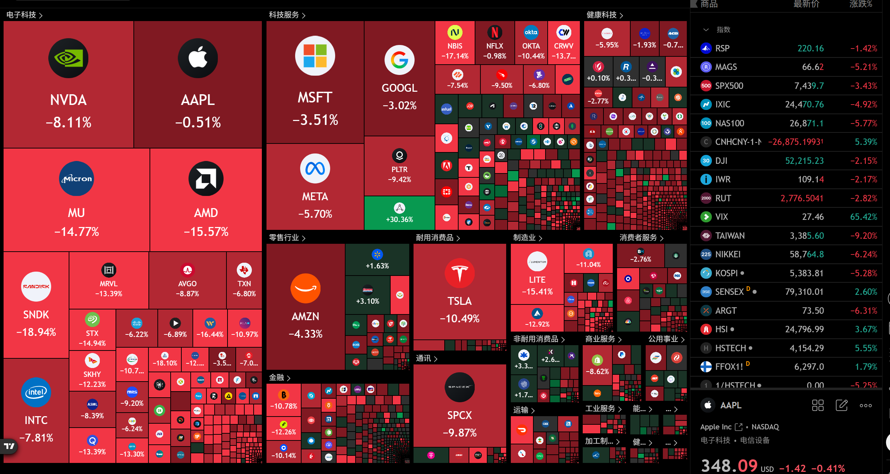

首先先贴一句Margin Call当中的话用于警示："And there have always been and there always will be the same percentage of winners and losers. Happy fucks and sad sucks, fat cats and starving dogs, in this world. Yeah, there may be more of us today than there's ever been. But the percentages, they stay exactly the same." 市场永远充满赢家和输家，想好自己到底做哪边的人。

消息面上，共和党占据两院之后，直接宣布要推动禁止AI法案。在这个催化剂推动下，市场的做空+多头踩踏+期货期权对冲+杠杆爆仓/斩仓资金合力推动大盘暴跌，这是入市以来除了关税战以外经历的最大的一次暴跌，算是体验了一回真正的大盘崩溃是什么样的：批量的明星股-10%到-20%的下跌，如果真持有这些票应该很绝望吧。

不过，单日暴跌6%，在市场整体波动率如此大的情况下，个人认为接下来一段时间大概率都是高波动的情况：要么接着暴跌，要么迎接暴力反弹然后再继续下跌，要么双向插针打爆多空双方。针对每种情况都已经做好了预案，希望这次的暴跌对我来说是绝佳的机会，而不是埋葬。相信统计学和之前看盘的经验。