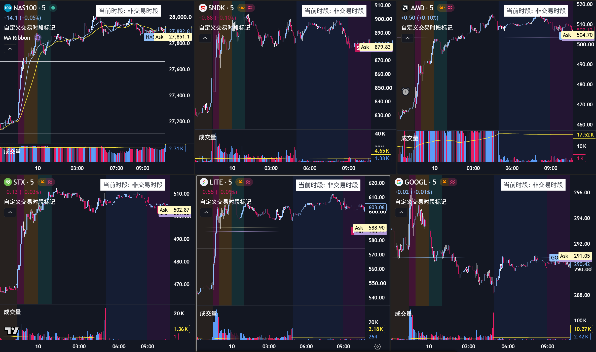

周五股市保持弱势之后，今天整个大盘出现了强力反弹，也就是全天上涨后半夜没有起伏的情况。**这两天反思，到底什么情况，个股表现跑赢大盘可以证明其强势，以及如何利用盘前盘后交易**。现在有了新的猜想：
1. 盘前的5分钟（虽然马上就要23小时交易了）的个股强弱没有任何观测价值
2. 市场平静时，个股的强度不具备预测性
3. **只有在市场出现暴跌之后，反弹的强度才能最好测试**

平时个股跑赢大盘或者跑输大盘不具备指引性，跑赢大盘也很有可能只是个股的波动大（β值更高而非创造了逆大盘的α），最多只能说明当前市场在关注什么。反而是暴跌，是更好的检验手段：大盘反弹之后，市场买盘更强的票反弹更剧烈且5分钟k线的强弱具有较强的参考价值。

平时减少在盘前（或者以后在流动性差的时间段交易）是有道理的，主要是**不要在市场平静的时候在盘前交易，因为流动性缺失让盘前价格波动失效**。但是，在**市场大幅波动的时候，要敢于盘前交易**：流动性充足的时候盘前非常容易出现极高极低点。（例如 今年二月三月那会战争预期加大了市场波动，所以总能成功；之后市场平静时尝试交易总是失效，但因为之前成功过所以误以为盘前就应该交易与找机会，参考P，NTAP最后一次亏损：盘前129平静没波动于是抄底，结果开盘后跌10%）

参考图片：LITE虽然反弹强劲，主要是β值在带动，而非股价强劲；SNDK虽然是历史明星股，但是最近NAND价格下跌导致基本面被削弱，所以全天反弹只有5%是弱反弹；AMD跌幅小于前面两个但是反弹力度更强，且盘中5分钟伴随突破，说明是真正具有板块alpha的个股。