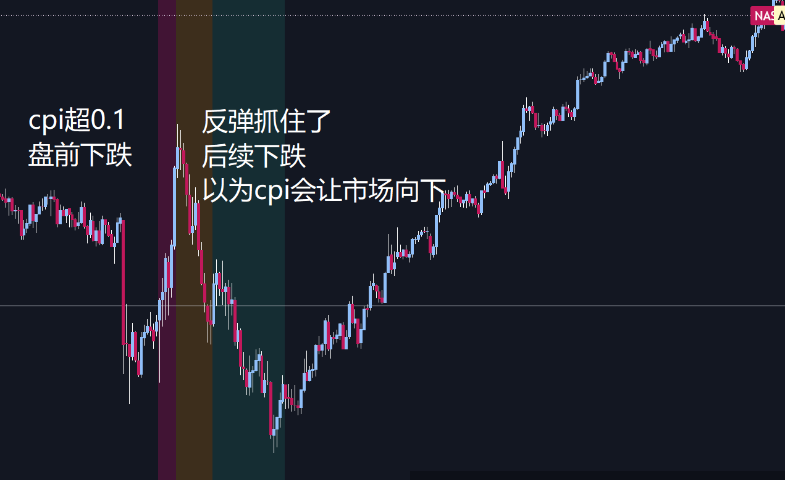

昨天犯了个非常严重的错误：
cpi超预期0.1%之后，市场在开盘后强劲反弹，但是随后开始阴跌。一开始由于价格下跌，以为市场受到了周一暴涨的刺激在追高，后续逐渐realize CPI超预期的事实所以下跌，**这属于看到价格之后pua自己！不要过度的相信价格的移动方向！**

**对于数据的解读，应该注意区分表象与里象**：昨天的数据当中，表象是cpi超预期，里象是cpi的driven factor是油价，而10月油价与9月油价平均价接近所以cpi高是正常的，但是没有大超预期。既然当前信息支持美国伊朗之间停止争斗，油价也已经开始下行，那么表象cpi超预期就是假的！

昨天收盘前价格反弹后思考了很久，到底方向在哪边，最后选择了不在尾盘追，截止写稿前，之前的判断都是错的。也是受几个方面影响：1. A9在市场暴跌后的极端悲观发言；2. GPT的回答（**如果犹豫不决，不要问AI帮你做决定！！！AI纯傻子，只能做笨工作，就像初级分析师那样**）；3.价格下跌的解读。

因为历史上没有什么比较好的参考，所以没法像周四大跌后抄底那样自信。不过希望有了这次经历和反思之后能更进一步。