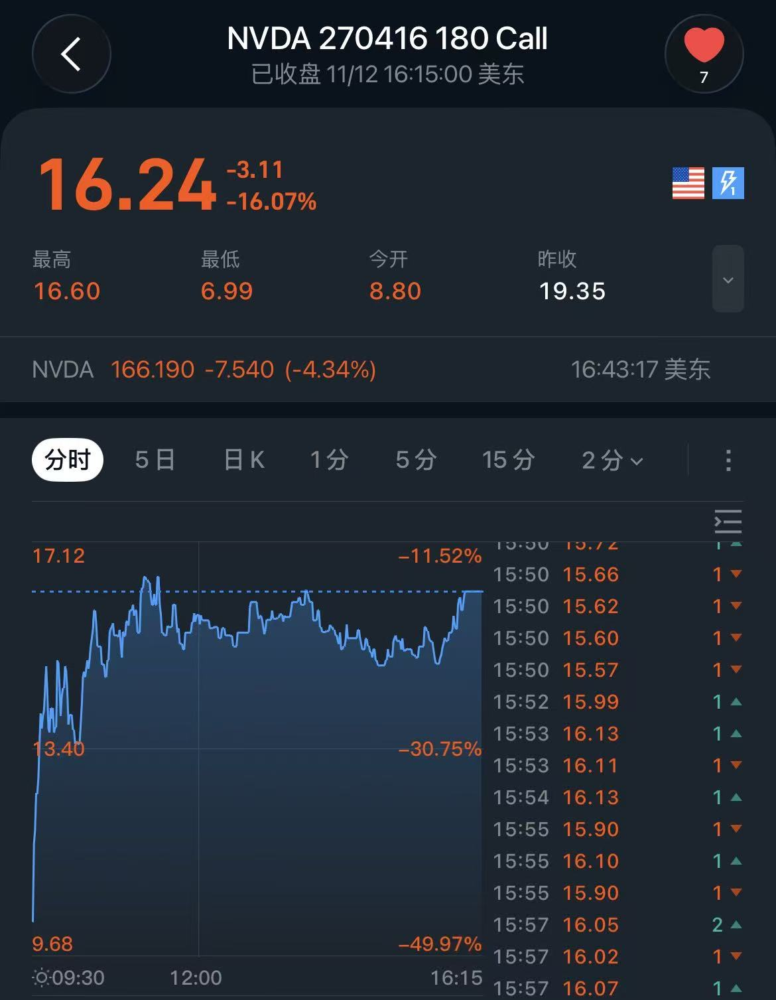

今天整体的判断大致没错，英伟达和黄仁勋事件导致的股价承压差不多就要见底了；开盘前英伟达股价被一路打压12%，也是判断开盘后拉升于是果断腾挪AMD资金抄底LITE最后成功；盘中又交易了几笔AXTI和LITE做t降低了一些成本。

几个重要的思考：

**1. 盘前盘后与夜盘时段的交易的选择**

尽管之后会改变为23小时交易，但是仍然值得研究。反思一下过去的操作，如果考虑在交易时段外进行交易，最好的规则如下：
- 大部分的交易时段外的任何下单应该发生在盘前，且应该临近开盘
- 周一可以在夜盘少量交易，如果周末发生大事件
- **盘后时段管住手不交易**

如同上一个反思中表述的，大部分的交易应该是盘中去做的，时段外的流动性较差所以通常不能良好的定价发生的事情。盘前时段是流动性集中的时段，且大部分的公司事件也已经发生，如果发生暴跌或者暴涨可以有现金或者仓位用于应对；夜盘流动性最差，但是如果周末发生大事件，夜盘是开仓/跑路的好时机的情况下可以开仓。**不可以在盘后时段开仓**，主要原因是流动性差，且无法预知后半夜发生的事情，在盘后开仓相当于承担了额外的风险却没有任何的补偿。

---

**2. 个股因为事件驱动，暴跌时期权抄底到底应不应该关注波动率**

说结论：**不关注！**在暴跌之后，期权波动率会上升并维持一段时间，但是不会短期消失。而一旦探底反弹，5-10%的股价上涨幅度通常意味着OTM call 70-100%的上涨幅度，远远大于波动率损失的价值。因此，可以在暴跌的时候尝试买OTM期权。

