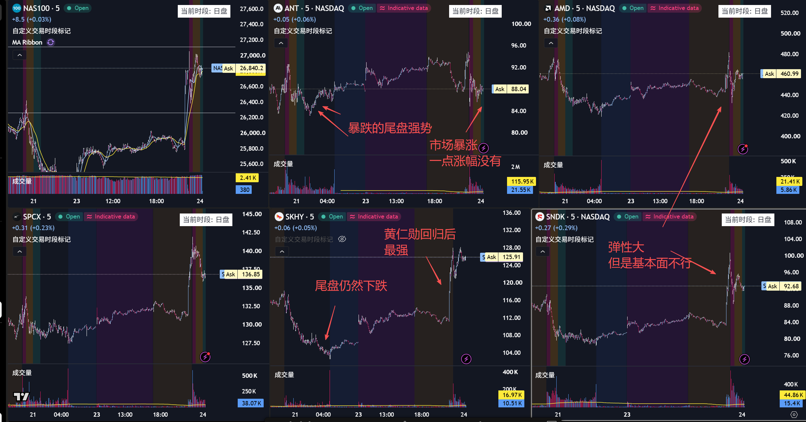

周五NAS100下跌6%的时候就已经意识到周一开盘大概率是要往上反弹的，所以大约抄底了7成的仓位，但是因为看到周五下跌的时候ANT和SPCX的尾盘表现好所以就更多的抄底了这两个票，ANT的仓位甚至有40%，显然在熊市的时候，这种非同一个板块上的价格表现优劣通常是骗人的。**所以，后续遇到大盘暴跌然后抄底的时候，要平均分摊仓位，每个股票最好不要有偏袒。**

此外，如果遇到暴跌抄底之后，不要在盘前交易！不要在盘前交易！不要在盘前交易！有人看到价格移动然后就手痒，不要因为盘前回吐了部分利润就跑路。做的正确的事情就不要着急松口，一定要解决 赚只赚小的亏就亏大的 的问题。

**哪些做得对：**
- 消息出来后知道一定会高开低走，所以开盘前卖空
- 全天没有尝试继续追高

**哪些做的错：**
- 盘前清仓海力士，正好在黄仁勋回归消息出来后清仓，痛失一大笔肉 （**还是那个最大的问题，该拿住的时候拿不住**，不该拿的时候总是持有的时间更长。总是怕回撤，或许熊市就是这样）
- 大仓位ANT，没有考虑暴跌-14%的英伟达
- 开盘的空单没有拿更长的时间